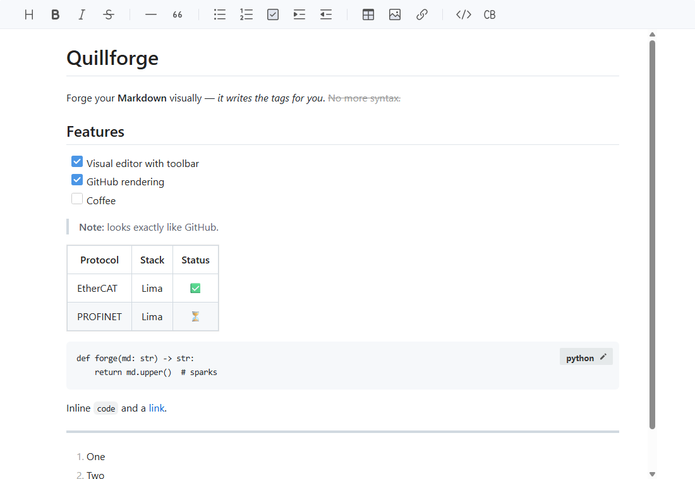

<p align="center"></p>

<h1 align="center">Gryphmark</h1>
<p align="center"><b>Write Markdown visually. See it like GitHub.</b><br><i>Escribí Markdown en forma visual. Miralo como en GitHub.</i></p>

<p align="center"></p>

> **Windows 10/11 on x64 (64-bit Intel or AMD) only.** There is no build for ARM processors.
> Solo para Windows 10/11 en x64 (Intel o AMD de 64 bits); no hay versión para procesadores ARM.

---

## English

Gryphmark is a Markdown viewer and editor for Windows. Format with buttons — headings, bold, lists, tables, code — and
Gryphmark writes the Markdown tags for you. Documents are rendered exactly like GitHub, in light or dark theme.

**Live reload.** When another program changes the open file, such as an AI assistant editing it, Gryphmark shows
the new text at once and stays where you were reading. It also follows tools that save by writing a new file and
renaming it over the old one.

**Download:** the setup is in [Releases](https://github.com/Gabriel-Castiglia/gryphmark-windows/releases/latest).

**macOS version:** <https://github.com/Gabriel-Castiglia/gryphmark> (Apple silicon only).

- Visual editor, Markdown source with live preview, and read-only GitHub preview (`Ctrl+1/2/3`)
- English and Spanish interface, switchable at runtime
- Relative images and links, `.md` links open in Gryphmark
- GitHub alerts, Mermaid diagrams, math, footnotes and emoji
- **Files panel**: open a whole folder and browse its Markdown files in a tree beside the document, like VS Code or Obsidian (`Ctrl+Shift+E`); several folders at once, each with its own colour, pinning, sorting and a choice of what opens at start
- **Read only**: the *Edit | Read only* switch in the toolbar locks the text so nothing changes by mistake (`Ctrl+Shift+L`)
- **Themes**: light, dark or automatic (follows Windows), and a colour catalogue that changes the icon everywhere in Windows and the highlights of the app (*View → Theme…*)
- **Dedicated instances**: open a file or folder in its own Gryphmark, separate from the main window (`--profile "Name"`, or right-click in the Files panel → desktop shortcut)
- **Zoom bar** in the status bar (also `Ctrl` + mouse wheel); on a narrow window the buttons that do not fit go into a ⋯ menu
- Find & replace, spell check; a sidebar with the files above and the outline below, as on the Mac (drag its edge and the line between them)
- **Convert to TXT**: right-click a file in the Files panel; a .txt is written next to it, as the document reads in the GitHub view, and the Markdown file is not changed
- **Autosave**, on by default: a file with a name saves itself a moment after you stop typing; the *Autosave* switch in the toolbar (also *File → Autosave*) turns it off. It never writes over a change made by another program
- Keeps your formatting: only edited lines change on save (CRLF/BOM preserved)
- Links in a document open only web pages, e-mail, other Markdown files, pictures and PDFs; a link to any other file shows it in Explorer instead of running it
- Crash recovery, single instance, update check
- Export to self-contained HTML, print / save as PDF
- Per-user installer (no admin rights), optional `.md` association
- Manuals: [`docs/Gryphmark_Manual_EN.pdf`](docs/Gryphmark_Manual_EN.pdf)

**Build** (on Windows x64): .NET 10 SDK, Node.js with npm, Inno Setup 6 and a Chromium browser (Edge, Chrome or
Brave) to print the manuals. The version is written only in `<Version>` of `src/Gryphmark/Gryphmark.csproj`.

```powershell
powershell -ExecutionPolicy Bypass -File build.ps1
# -> out/Gryphmark-Setup-<version>.exe
```

`-SkipNpm` keeps the web bundle in `src/Gryphmark/wwwroot/lib` as it is. `-Art` redraws the icons and the installer
pictures, which are committed; it needs Python 3 with Pillow, numpy, scipy and opencv-python.
The versions used for the released build are listed under *Build tools* below.

Up to version 1.1.1 Gryphmark was called Quillforge. The new installer removes the old version and
the settings are carried over.

## Español

Gryphmark es un visor y editor de Markdown para Windows. Das formato con botones —títulos, negrita, listas, tablas,
código— y Gryphmark escribe las etiquetas de Markdown por vos. Los documentos se ven exactamente como en GitHub, con
tema claro u oscuro.

**Recarga en vivo.** Cuando otro programa cambia el archivo abierto, por ejemplo un asistente de IA que lo edita,
Gryphmark muestra el texto nuevo enseguida y no te mueve de donde estabas leyendo. También sigue a las herramientas
que guardan escribiendo un archivo nuevo y renombrándolo encima del viejo.

**Descarga:** el instalador está en [Releases](https://github.com/Gabriel-Castiglia/gryphmark-windows/releases/latest).

**Versión para macOS:** <https://github.com/Gabriel-Castiglia/gryphmark> (solo Apple silicon).

- Editor visual, código Markdown con vista previa en vivo y vista GitHub de solo lectura (`Ctrl+1/2/3`)
- Interfaz en inglés y en español, se cambia sin reiniciar
- Imágenes y enlaces relativos; los enlaces a `.md` se abren en Gryphmark
- Avisos de GitHub, diagramas Mermaid, fórmulas, notas al pie y emojis
- **Panel de archivos**: abrís una carpeta entera y recorrés sus archivos Markdown en un árbol al costado del documento, como en VS Code u Obsidian (`Ctrl+Shift+E`); varias carpetas a la vez, cada una con su color, fijado, orden y qué se abre al iniciar
- **Solo lectura**: el selector *Editar | Solo lectura* de la barra bloquea el texto para que nada cambie por error (`Ctrl+Shift+L`)
- **Temas**: claro, oscuro o automático (sigue a Windows), y un catálogo de colores que cambia el ícono en todo Windows y el resaltado de la app (*Ver → Tema…*)
- **Instancias dedicadas**: abrir un archivo o una carpeta en su propio Gryphmark, separado de la ventana principal (`--profile "Nombre"`, o clic derecho en el panel de archivos → acceso directo en el escritorio)
- **Barra de zoom** en la barra de estado (también `Ctrl` + rueda del mouse); con la ventana angosta, los botones que no entran van a un menú ⋯
- Buscar y reemplazar, esquema lateral (se ensancha arrastrando su borde), revisión ortográfica
- **Convertir a TXT**: clic derecho en un archivo del panel de archivos; se escribe un .txt al lado, como se lee el documento en la vista GitHub, y el archivo Markdown no cambia
- Respeta tu formato: al guardar sólo cambian las líneas editadas (conserva CRLF/BOM)
- Los enlaces de un documento solo abren páginas web, correo, otros archivos Markdown, imágenes y PDF; un enlace a cualquier otro archivo lo muestra en el Explorador en vez de ejecutarlo
- Recuperación ante cierres, instancia única, aviso de actualizaciones
- Exportar a HTML autónomo, imprimir o guardar como PDF
- Instalador por usuario (sin permisos de administrador), asociación opcional de `.md`
- Manuales: [`docs/Gryphmark_Manual_ES.pdf`](docs/Gryphmark_Manual_ES.pdf)

**Compilar** (en Windows x64): SDK de .NET 10, Node.js con npm, Inno Setup 6 y un navegador Chromium (Edge, Chrome
o Brave) para imprimir los manuales. La versión se escribe solo en `<Version>` de `src/Gryphmark/Gryphmark.csproj`.

```powershell
powershell -ExecutionPolicy Bypass -File build.ps1
# -> out/Gryphmark-Setup-<versión>.exe
```

`-SkipNpm` deja como está el paquete web de `src/Gryphmark/wwwroot/lib`. `-Art` vuelve a dibujar los íconos y las
imágenes del instalador, que ya están en el repositorio; necesita Python 3 con Pillow, numpy, scipy y opencv-python.
Las versiones con que se compiló la versión publicada están abajo, en *Build tools*.

Hasta la versión 1.1.1 Gryphmark se llamaba Quillforge. El instalador nuevo quita la versión anterior y la
configuración se copia sola.

## Project layout / Estructura

| Path | Content |
|---|---|
| `src/Gryphmark/` | WPF + WebView2 app (C#) and `wwwroot/` editor page |
| `_npm/` | Web dependencies and esbuild entry (`entry.js`) |
| `installer/` | Inno Setup script and wizard art |
| `tools/` | Icon, wizard art and manual generators; `jstest.py`, a headless test of the editor page |
| `docs/` | Manuals (HTML + PDF, EN/ES) and screenshots |
| `out/` | Build output: publish folder and installer |

## Build tools / Herramientas de compilación

Gryphmark 1.9.0 was built and tested with / se compiló y probó con:

| Tool | Version |
|---|---|
| Windows 11 Pro | x64 |
| .NET SDK / runtime (self-contained) | 10.0.404 / 10.0.15 |
| Microsoft.Web.WebView2 (NuGet) | 1.0.2903.40 |
| Node.js / npm | 26.12.1 / 11.20.0 |
| esbuild | 0.25.5 |
| Inno Setup | 6.7.3 |
| Google Chrome (manual PDFs) | 157.0.8103.51 |
| Python (`-Art` only) | 3.13.17, Pillow 12.3.0, numpy 2.5.4, scipy 1.18.1, opencv-python 5.0.0 |

Web libraries / Bibliotecas web (exact versions in `_npm/package-lock.json`): TOAST UI Editor 3.2.2,
marked 15.0.12, KaTeX 0.19.1, Mermaid 12.3.0, highlight.js 11.11.1, jsdiff 9.0.0, DOMPurify 3.4.17,
github-markdown-css 5.8.1, gemoji 8.1.0.

## License / Licencia

Copyright (C) 2026 Gabriel Castiglia.

Gryphmark is free software: you can redistribute it and/or modify it under the terms of the GNU General
Public License, version 2 only (GPL-2.0-only), as published by the Free Software Foundation. It is
distributed WITHOUT ANY WARRANTY. See [`LICENSE`](LICENSE) for the full text.

Gryphmark es software libre: podés redistribuirlo y/o modificarlo bajo los términos de la GNU General
Public License, versión 2 únicamente (GPL-2.0-only). Se distribuye SIN NINGUNA GARANTÍA. El texto completo
está en [`LICENSE`](LICENSE).

## Credits / Créditos

| Component | License |
|---|---|
| TOAST UI Editor, ProseMirror, marked (+ alert, footnote, katex extensions), github-markdown-css, Mermaid, KaTeX, gemoji | MIT |
| highlight.js, jsdiff | BSD-3-Clause |
| DOMPurify | MPL-2.0 (used under the MPL-2.0 option of its MPL-2.0 / Apache-2.0 dual licence) |
| .NET 10 / WPF | MIT |
| Microsoft Edge WebView2 SDK | Microsoft WebView2 SDK license (redistributable); the WebView2 Runtime is a Windows system component |
| Icon / ícono: griffin from Martin Schongauer's engraving (c. 1485), The Metropolitan Museum of Art — quill added | CC0 |
