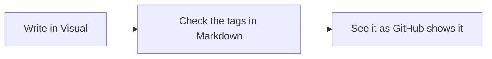

# Welcome to Gryphmark

This is a **sample document**. Change it as much as you like: it opens as an untitled copy, so the original is never overwritten. Save it with **Save as** if you want to keep your version.

> [!TIP]
> Try the three buttons at the right end of the toolbar — **Visual · Markdown · GitHub** — or press `Ctrl+1`, `Ctrl+2` and `Ctrl+3`. It is the same document seen three ways.

## The three views

| View | Shortcut | What you see |
|:--|:--:|:--|
| **Visual** | `Ctrl+1` | The formatted document. Type and use the buttons; Gryphmark writes the tags. |
| **Markdown** | `Ctrl+2` | The Markdown text on the left and a live preview on the right. |
| **GitHub** | `Ctrl+3` | Read-only: the page exactly as GitHub will show it. |

1. You are probably in **Visual** now. Select a word and press `Ctrl+B`: it turns **bold**.
2. Switch to **Markdown**: the same word now has `**` on each side. Those are the tags.
3. Switch to **GitHub**: the diagram and the formula further down are drawn, as on github.com.

## Text

Plain text, *italic*, **bold**, ~~strikethrough~~, `inline code` and a [link to GitHub](https://github.com). Emoji by name work too :sparkles: :rocket:, and so do footnotes.[^1]

- A bulleted list
  - with a nested item
- [x] A task that is done
- [ ] A task still to do

> A quote. In the Markdown view it is a line that starts with `>`.

## Code

```python
def greet(name: str) -> str:
    return f"Hello, {name}!"
```

## Diagram (Mermaid)

Shown as code in Visual and Markdown; drawn in the GitHub view.



## Math (KaTeX)

The entropy of a random password: $H = L \cdot \log_2 N$

$$
\sum_{k=1}^{n} k = \frac{n(n+1)}{2}
$$

## Alerts

> [!NOTE]
> Useful information the reader should know.

> [!WARNING]
> Something that needs attention.

## Folders

Open a whole folder with **File → Open folder…** and its Markdown files appear in a tree on the left, like in VS Code or Obsidian. Click a file to open it; `Ctrl+Shift+E` shows or hides the panel.

---

To stop showing this sample in **File → Open recent**, right-click it there and choose **Hide sample**. It is always available again from **Help → Sample document**.

[^1]: A footnote: it is listed at the end of the page in the GitHub view.
