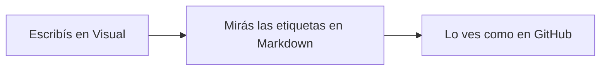

# Bienvenido a Gryphmark

Este es un **documento de ejemplo**. Cambialo todo lo que quieras: se abre como una copia sin título, así que el original nunca se pisa. Si querés conservar tu versión, guardala con **Guardar como**.

> [!TIP]
> Probá los tres botones del extremo derecho de la barra — **Visual · Markdown · GitHub** — o apretá `Ctrl+1`, `Ctrl+2` y `Ctrl+3`. Es el mismo documento visto de tres maneras. ¿Solo vas a leer? Elegí **Solo lectura** al lado (`Ctrl+Shift+L`) y nada cambia por error.

## Las tres vistas

| Vista | Atajo | Qué ves |
|:--|:--:|:--|
| **Visual** | `Ctrl+1` | El documento con formato. Escribís y usás los botones; Gryphmark escribe las etiquetas. |
| **Markdown** | `Ctrl+2` | El texto Markdown a la izquierda y la vista previa en vivo a la derecha. |
| **GitHub** | `Ctrl+3` | Solo lectura: la página tal cual la va a mostrar GitHub. |

1. Seguramente estás en **Visual**. Seleccioná una palabra y apretá `Ctrl+B`: queda en **negrita**.
2. Pasá a **Markdown**: la misma palabra ahora tiene `**` a cada lado. Esas son las etiquetas.
3. Pasá a **GitHub**: el diagrama y la fórmula de más abajo se dibujan, como en github.com.

## Texto

Texto normal, *cursiva*, **negrita**, ~~tachado~~, `código en línea` y un [enlace a GitHub](https://github.com). También andan los emoji por nombre :sparkles: :rocket: y las notas al pie.[^1]

- Una lista con viñetas
  - con un elemento anidado
- [x] Una tarea terminada
- [ ] Una tarea pendiente

> Una cita. En la vista Markdown es una línea que empieza con `>`.

## Código

```python
def saludar(nombre: str) -> str:
    return f"¡Hola, {nombre}!"
```

## Diagrama (Mermaid)

En Visual y Markdown se ve como código; en la vista GitHub se dibuja.



## Fórmulas (KaTeX)

La entropía de una contraseña aleatoria: $H = L \cdot \log_2 N$

$$
\sum_{k=1}^{n} k = \frac{n(n+1)}{2}
$$

## Avisos

> [!NOTE]
> Información útil que conviene saber.

> [!WARNING]
> Algo que requiere atención.

## Carpetas

Abrí una carpeta entera con **Archivo → Abrir carpeta…** y sus archivos Markdown aparecen en un árbol a la izquierda, como en VS Code u Obsidian. Podés abrir varias carpetas; cada una tiene su color, y el botón **⋯** del panel las ordena, cambia los colores y elige qué se abre al iniciar. Clic en un archivo para abrirlo; `Ctrl+Shift+E` muestra u oculta el panel.

---

Para que este ejemplo no aparezca más en **Archivo → Abrir reciente**, elegí **Ocultar ejemplo**, justo debajo de él (o desmarcá **Ayuda → Mostrar el ejemplo en Abrir reciente**). Siempre lo podés volver a abrir desde **Ayuda → Documento de ejemplo**.

[^1]: Una nota al pie: en la vista GitHub aparece al final de la página.
